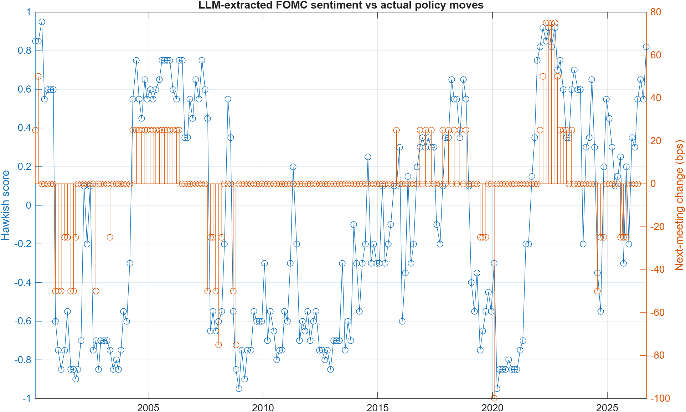

# FOMC Minutes Analysis with LLMs (MATLAB RAG Pipeline)

A MATLAB-based retrieval-augmented generation (RAG) system that analyzes 26 years
of Federal Open Market Committee meeting minutes, answers natural-language questions
about monetary policy grounded in the source documents, and extracts hawkish/dovish
sentiment scores that are backtested against the Fed's actual rate decisions.

Built for [MathWorks Challenge Project #258](https://github.com/mathworks/MATLAB-Simulink-Challenge-Project-Hub/tree/main/projects/Federal%20Open%20Market%20Committee%20Minutes%20Analysis%20with%20Large%20Language%20Models).

## Results

LLM-extracted sentiment vs. actual next-meeting policy moves, 2000–2026:



| Metric | Value |
|---|---|
| Meetings analyzed | 215 (2000–2026, incl. the two PDF-only releases) |
| Corpus size | 12337 embedded text chunks |
| Spearman correlation (sentiment vs. next rate change) | **0.559** |
| Directional hit rate on actual rate moves | **94.0% (63/67)** |
| 3-class (cut/hold/hike) accuracy | **33.0%** |
| Naive last-move baseline (directional) | 85.1% |

Every number above can be recomputed from the committed
`results/fomc_sentiment_scores.csv` by running `results/verify_metrics.m` —
no database, API key, or pipeline re-run required. Scoring runs at
temperature 0 and records the exact serving model per score, so the
metrics are reproducible.

The corpus updates itself: re-running the pipeline scrapes and scores any newly
published FOMC minutes automatically.

## Architecture

```
federalreserve.gov ──► step1: scraper (HTML + PDF minutes) ──► ../data/raw
                              │
              step2: extract → chunk by paragraph → embed (all-MiniLM-L12-v2, 384-d)
                              │          (batched loads via staging table)
                   PostgreSQL + pgvector (HNSW index)
                              │
      step3 / fomcApp: RAG Q&A ── HNSW retrieval + date filtering ──► Claude API
                              │
      step4: sentiment scoring (temp 0) ──► backtest vs FRED rate data
                              │
                   results/fomc_sentiment_scores.csv + verify_metrics.m
```

## A bug worth mentioning: the January problem

The first version of the sentiment scorer fed each meeting's *first 25 chunks* to
the LLM. Result: January meetings systematically scored 0.00. Why? January FOMC
meetings are annual organizational meetings — their opening pages are attendance
rosters and legal boilerplate (foreign-currency authorization renewals), not policy
discussion. The LLM correctly found no signal in a phone directory.

Fix: select chunks by *relevance* instead of position — embed a policy probe query
("inflation outlook, economic conditions, and the appropriate stance of monetary
policy") and retrieve each meeting's 25 most similar chunks via pgvector.

Effect on the original run: Spearman 0.556 → 0.568 and directional hit rate
88.1% → 94.0%, with January meetings scoring consistently with their era.
(Current headline numbers in the table above come from the temperature-0 rerun.)

## Setup

Requirements: MATLAB R2024a+ (Text Analytics, Database, Statistics & ML, Deep
Learning toolboxes), the all-MiniLM-L12-v2 support package, PostgreSQL with
[pgvector](https://github.com/pgvector/pgvector), and an Anthropic API key.

1. Create the database: `psql -U postgres -f sql/setup_database.sql`
   (existing v1 databases: run `sql/migrate_v2.sql` instead)
2. Download rate data from FRED into `data/`:
   [DFEDTAR](https://fred.stlouisfed.org/series/DFEDTAR) and
   [DFEDTARU](https://fred.stlouisfed.org/series/DFEDTARU) (full history)
3. In MATLAB, set credentials each session:
```matlab
   setenv("FOMC_DB_PASSWORD", "your-postgres-password")
   setenv("ANTHROPIC_API_KEY", "sk-ant-...")
```
4. Run `src/main.m` — it executes the full pipeline (scrape → embed → RAG demo →
   backtest) with skippable stages. Individual step scripts can also be run
   directly, and `fomcApp` launches the interactive explorer.

All scripts are re-runnable; completed work is skipped.

## Interactive app

`src/fomcApp.m` is a small uifigure app over the same retrieval/generation
function the scripts use (`ragAnswer.m`): type a question, pick a date range
and Top-K, and get the retrieved chunks plus a grounded, citation-bearing
answer.

## Design notes

- **Custom API client** (`callClaude.m`): a minimal webwrite-based Anthropic
  client — temperature 0 by default, retry with exponential backoff on rate
  limits/transient failures, model ID returned with every call, model name
  configurable per call.
- **Date-filtered retrieval**: chunks carry meeting dates; the search range is
  set explicitly (the `dateRange` variable in `step3_rag_query.m`, or the date
  pickers in the app) and applied before similarity ranking. Retrieval orders
  by pgvector's `<=>` operator directly so the HNSW index is used.
- **Rate-regime stitching**: pre-Dec-2008 target rate (DFEDTAR) and post-2008
  upper bound (DFEDTARU) are merged into one continuous ground-truth series.
- **Calendar-based backtest pairing**: each score is paired with the next
  meeting on the full corpus calendar (never by adjacency in the scores
  table), and every excluded pair is counted and reported.

## Limitations

- LLM training data includes historical knowledge of Fed decisions, so scores are
  not pure out-of-sample forecasts; the claim tested is that the minutes *contain*
  extractable policy signal, not that the system predicts blind.
- Sentiment is scored per meeting in isolation; no cross-meeting context.

## Development notes: AI assistance

The README and the descriptive comments at the top of each source file were
drafted with the assistance of Anthropic's Claude, consistent with the
program's [Generative AI Guidelines](https://github.com/mathworks/MATLAB-Simulink-Challenge-Project-Hub/wiki/Generative-AI-Guidelines).
All content was reviewed and edited by the author. Claude is also a runtime
component of the system itself (`callClaude.m`).

## License

MIT
